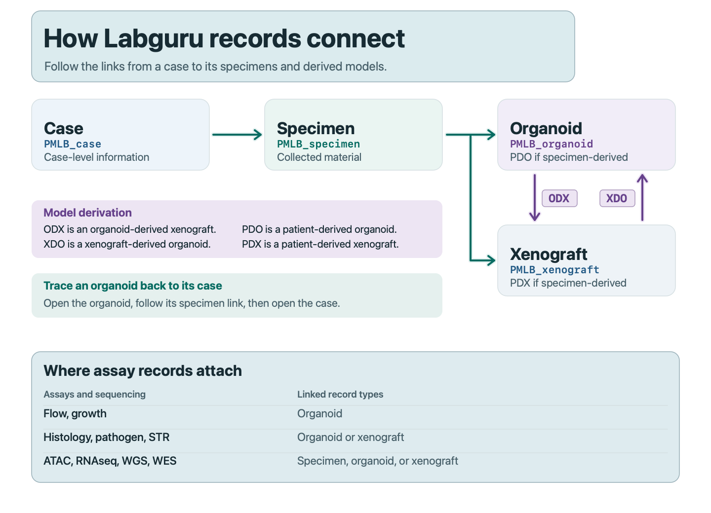

# Labguru Database

This section covers how PMLB data is organized in Labguru: how records connect,
how IDs are named, the full [schema](schema/index.md), and how to
[upload](upload/index.md), [search](search/index.md), and
[download](download/index.md) data.

## How Labguru records connect

Every record traces back to a **case**:

| Record | Labguru collection | What it holds |
|--------|--------------------|---------------|
| Case | `PMLB_case` | Case-level (patient) information |
| Specimen | `PMLB_specimen` | Collected material from a case |
| Organoid | `PMLB_organoid` | Organoid model record (a PDO if derived from a specimen) |
| Xenograft | `PMLB_xenograft` | Xenograft model record (a PDX if derived from a specimen) |

Models can also be derived from each other:

- **ODX** (organoid-derived xenograft): a xenograft grown from an organoid.
- **XDO** (xenograft-derived organoid): an organoid grown from a xenograft.

### Trace an organoid back to its case

Follow the organoid's specimen link to the case.
For an XDO, use the source xenograft record (`source_xenograft_modeID` on the
organoid) to trace its derivation.

## Where assay records attach

| Assays and sequencing | Linked record types |
|-----------------------|---------------------|
| Flow, growth | Organoid |
| Histology, pathogen, STR | Organoid or xenograft |
| ATAC, RNAseq, WGS, WES | Specimen, organoid, or xenograft |

## Naming records

All PMLB records use a standard ID format, for example `PHLC0053.TXO1.r1`.
See [Naming Convention](naming_convention/index.md) for how to read and build these IDs.
