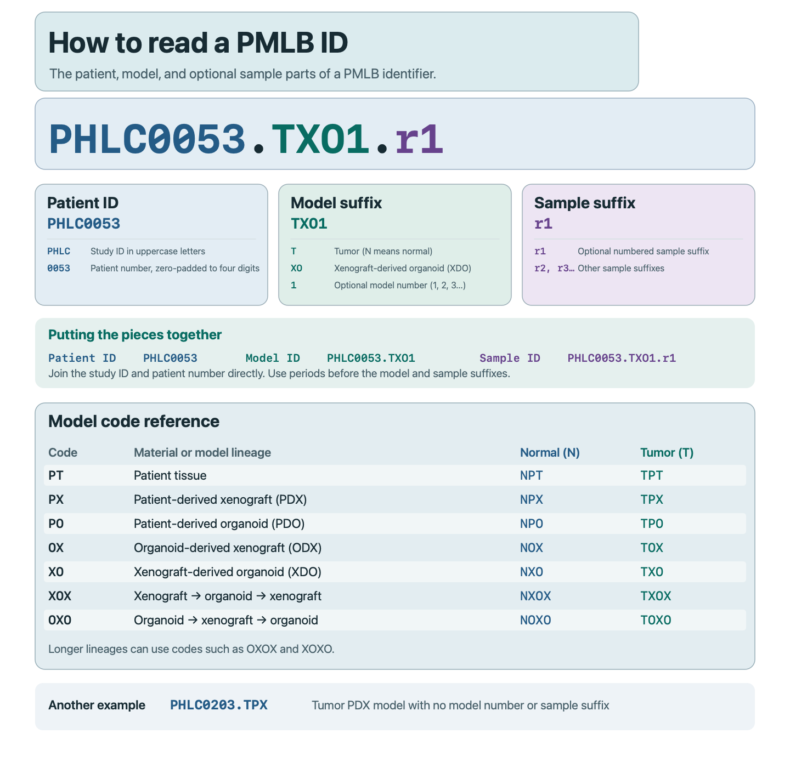

# Naming Convention

Every PMLB identifier is made of a **patient ID**, a **model suffix**, and an
optional **sample suffix**.

## Reading an ID

Example: `PHLC0053.TXO1.r1`

| Part | Example | Meaning |
|------|---------|---------|
| Study ID | `PHLC` | Study ID in uppercase letters |
| Patient number | `0053` | Patient number, zero-padded to four digits |
| Tumor / normal | `T` | `T` = tumor, `N` = normal |
| Model code | `XO` | Model lineage (see the table below); here, xenograft-derived organoid |
| Model number | `1` | Optional model number (1, 2, 3...) |
| Sample suffix | `r1` | Optional numbered sample suffix (`r1`, `r2`, `r3`...) |

## Putting the pieces together

| Level | Format | Example |
|-------|--------|---------|
| Patient ID | `<study><patient number>` | `PHLC0053` |
| Model ID | `<patient ID>.<T/N><model code><model number>` | `PHLC0053.TXO1` |
| Sample ID | `<model ID>.r<n>` | `PHLC0053.TXO1.r1` |

Join the study ID and patient number directly, with no separator.
Use a period before the model suffix and before the sample suffix.

## Model code reference

| Code | Material or model lineage | Normal (N) | Tumor (T) |
|------|---------------------------|------------|-----------|
| `PT` | Patient tissue | `NPT` | `TPT` |
| `PX` | Patient-derived xenograft (PDX) | `NPX` | `TPX` |
| `PO` | Patient-derived organoid (PDO) | `NPO` | `TPO` |
| `OX` | Organoid-derived xenograft (ODX) | `NOX` | `TOX` |
| `XO` | Xenograft-derived organoid (XDO) | `NXO` | `TXO` |
| `XOX` | Xenograft → organoid → xenograft | `NXOX` | `TXOX` |
| `OXO` | Organoid → xenograft → organoid | `NOXO` | `TOXO` |

Longer lineages can use codes such as `OXOX` and `XOXO`.

## More examples

| ID | Meaning |
|----|---------|
| `PHLC0053.TXO1.r1` | Patient 53, tumor xenograft-derived organoid #1, sample 1 |
| `PHLC0203.TPX` | Patient 203, tumor PDX model, no model number or sample suffix |
